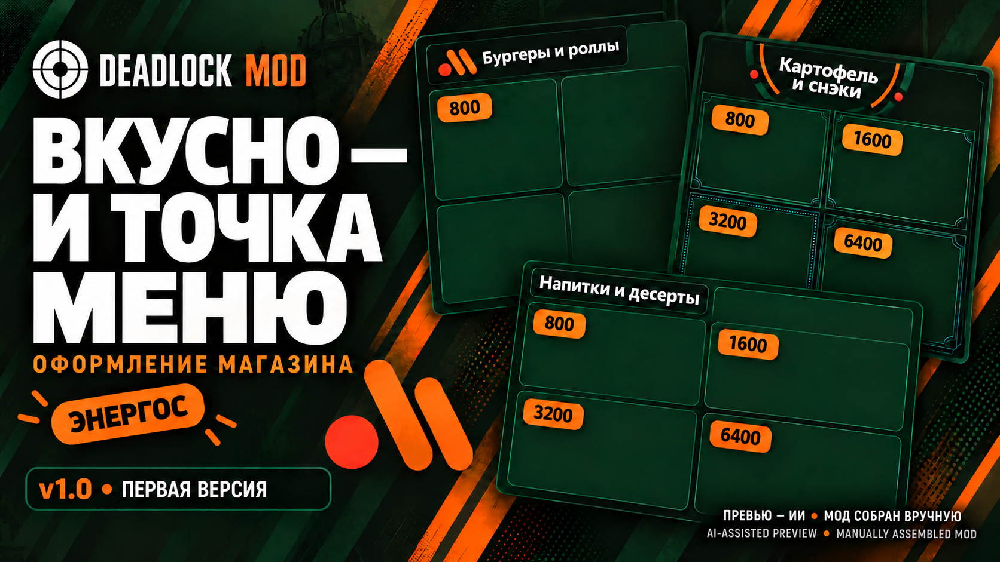

# Deadlock Local Flavor

**Знакомые вывески, еда и такси на улицах Deadlock.**

[Скачать](https://github.com/MeowKusTrue/deadlock-local-flavor/releases/latest) · [Установка](docs/INSTALL_RU.md) · [Совместимость](docs/COMPATIBILITY.md) · [English](README.en.md)

Набор моих косметических модов для Deadlock: «Вкусно — и точка» вместо лавки, меню предметов в том же стиле, банкомат ZБЕР и такси «Яндекс Go». Каждый мод ставится отдельно. Собирать всё сразу не нужно.

## 🍔 Что есть

| Мод | Версия | Что меняется |
| --- | --- | --- |
| [Вкусно — и точка](mods/shop/README.md) | 1.2 | Модель лавки. Звуки можно оставить штатными или заменить |
| [Вкусно — меню](mods/menu/README.md) | 1.0 | Экран покупки предметов: зелёный фон, рыжие ценники, светлые названия |
| [ZБЕР — банкомат душ](mods/atm/README.md) | 1.0 | Sinner’s Sacrifice: новая модель, анимация экрана и звуки |
| [Указатели и меню](mods/signs/README.md) | 1.0 | Малые меню и большие указатели у спусков к лавке |
| [Яндекс Go — классическое такси](mods/taxi/README.md) | 1.0 | Новая окраска исходного такси из игры |

Моды не меняют характеристики предметов, цены или выдаваемые награды. В релизе нет полной копии карты.

<table>
<tr><td width="50%"></td><td width="50%"></td></tr>
<tr><td></td><td></td></tr>
</table>

Обложки лавки, меню и банкомата сделаны с помощью ИИ. Это рекламные иллюстрации, а не скриншоты из игры. [Подробнее об изображениях и авторстве](docs/CREDITS.md).

## 📦 Как скачать и поставить

Откройте [Releases](https://github.com/MeowKusTrue/deadlock-local-flavor/releases/latest) и выберите нужный ZIP в разделе **Assets**. Кнопка **Code → Download ZIP** скачивает страницы репозитория, а не готовые моды.

1. Закройте Deadlock.
2. В Deadlock Mod Manager откройте **Mods Library → Add Local Mod** и выберите ZIP.
3. Проверьте название, добавьте мод и включите его.
4. Отключите старую версию того же мода. Затем запускайте игру.

В каждом обычном ZIP один VPK в корне. Картинки и исходники туда не добавлены.

**Хотите сразу названия и обложки в библиотеке?** Скачайте `Deadlock_Local_Flavor_DMM_Import_v1.0.0.zip`, распакуйте его и откройте `mod-interchange.json` через **Add mods → Open export file…**. Это отдельный пакет импорта, а не ZIP для Add Local Mod. Карточки добавляются выключенными; выберите, что включить. Для загрузки обложек нужен интернет. [Подробная инструкция](docs/MOD_MANAGER.md).

## 🔊 Какой вариант лавки выбрать

Выберите **один** основной архив:

| Окончание имени ZIP | Что внутри |
| --- | --- |
| `01_Original_Sounds` | Только модель лавки, без замены звуков |
| `02_Shop_Sounds` | Лавка, пиканье покупки и фоновая петля на 9 секунд |
| `03_Ability_Sound` | Лавка и джингл повышения способности |
| `04_All_Sounds` | Лавка и все три звуковые замены |

Для своего сочетания возьмите `01_Original_Sounds` и нужные `Extra_*_Only`. Extra-файлы содержат только звук и работают даже без модели лавки. HUD-меню звуки не подменяет.

## 🧩 Совместимость и ограничения

Лавка, HUD-меню, банкомат, указатели и классическое такси используют разные пути ресурсов. Проверка файлов не нашла между ними пересечений. С чужими модами смотрите, какой объект или экран они заменяют.

- Несколько основных вариантов лавки одновременно не нужны. Звуковые Extra-файлы не сочетайте с вариантом, где уже есть тот же звук.
- У банкомата пока нет экрана «115-ФЗ» после разрушения.
- Такси в релизе — исходная машина из Deadlock с новой окраской. **Haval здесь нет:** он ещё не перекрывает встроенное такси как надо.
- Указатели зависят от расположения объектов на карте. После обновлений игры их положение может потребовать правки.

Если после патча что-то сломалось, отключите конкретный мод и [сообщите об ошибке](https://github.com/MeowKusTrue/deadlock-local-flavor/issues/new?template=bug_report.yml). Приложите скриншот и название установленного ZIP.

## 🔄 Обновление и удаление

Отключите старый вариант и импортируйте новый ZIP из Releases. Не держите обе версии включёнными. Местные ZIP из GitHub не получают автоматические обновления каталога GameBanana — новые файлы нужно скачивать из этого репозитория.

Чтобы удалить мод, выключите его в менеджере. Для ручной установки и удаления есть [отдельная инструкция](docs/INSTALL_RU.md).

## 🎨 Авторство

Автор сборок — **MeowKusTrue**. Модели лавки и банкомата сделаны вручную; такси использует исходную модель игры. Геометрия, размещение, материалы и сборка модов подготовлены вручную и скриптами. Для части иллюстраций меню и табличек использован ИИ.

Игровые ассеты принадлежат Valve. Чужие логотипы, музыка и звуки принадлежат их владельцам. Коллекция не связана с Valve, «Вкусно — и точка», Яндексом или Сбером. [Авторство и происхождение материалов](docs/CREDITS.md).

## 🛠️ Для обновления репозитория

Файлы модов лежат в **Releases**, здесь — описания, обложки, каталог и инструменты проверки упаковки. [Как выпустить следующую версию](docs/RELEASING.md).

[Наверх](#deadlock-local-flavor)

