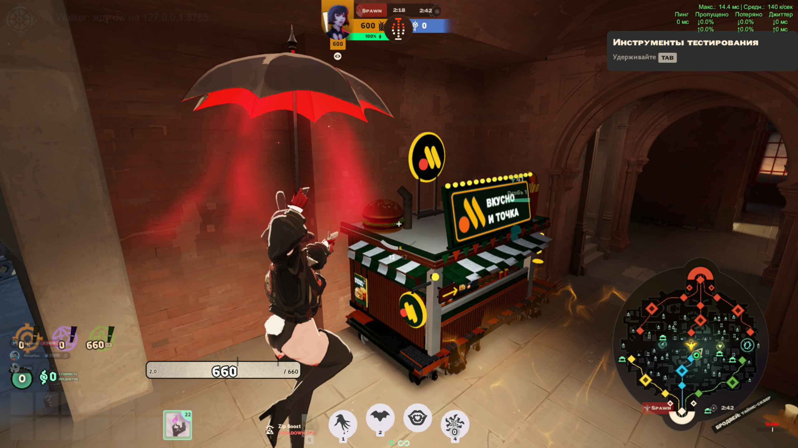
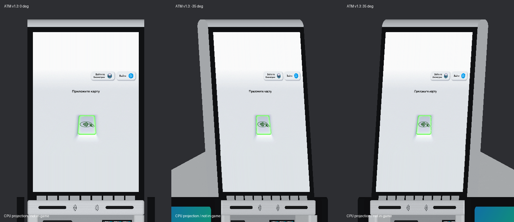
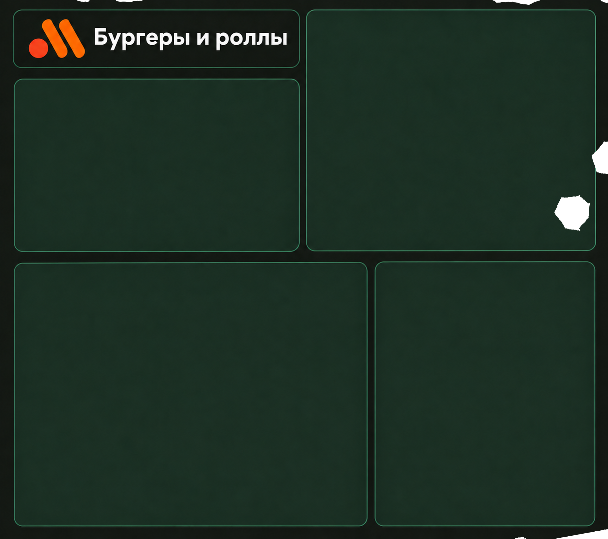
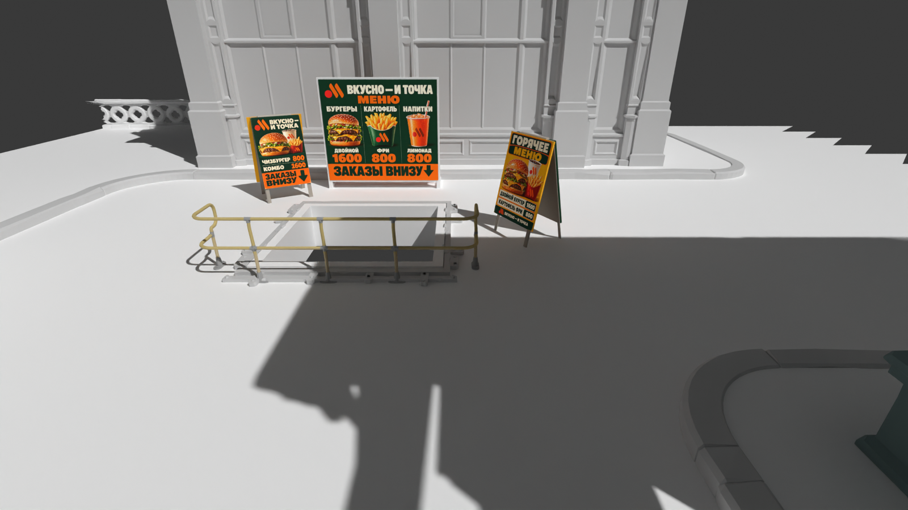
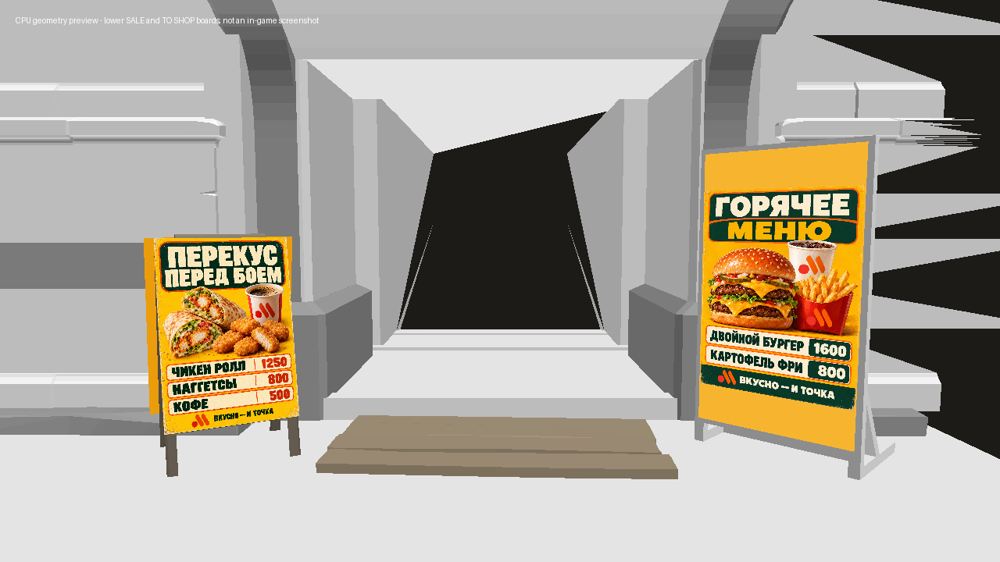
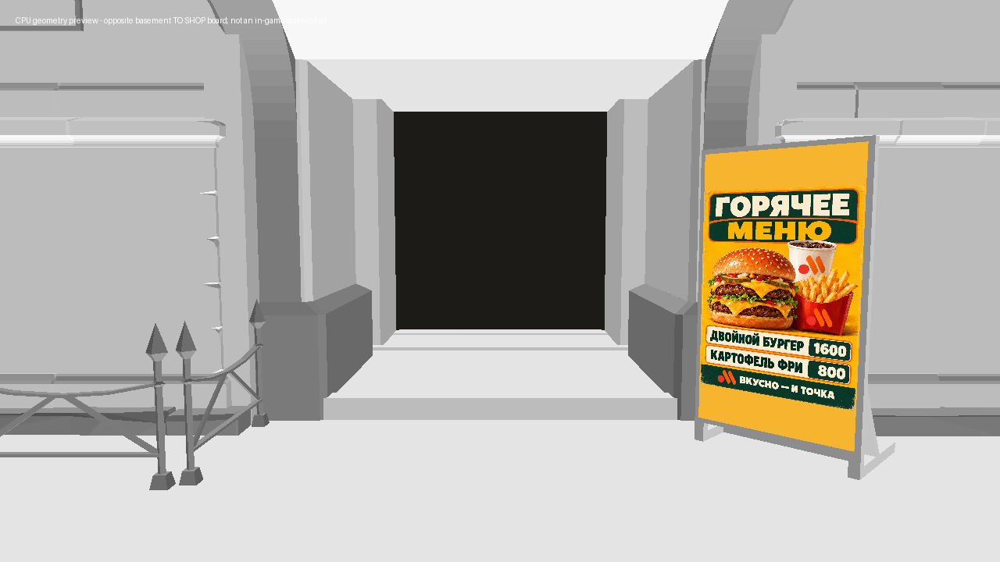
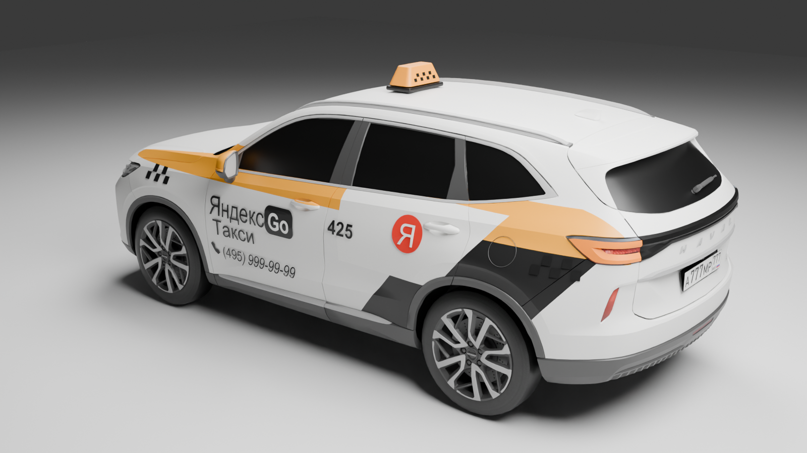
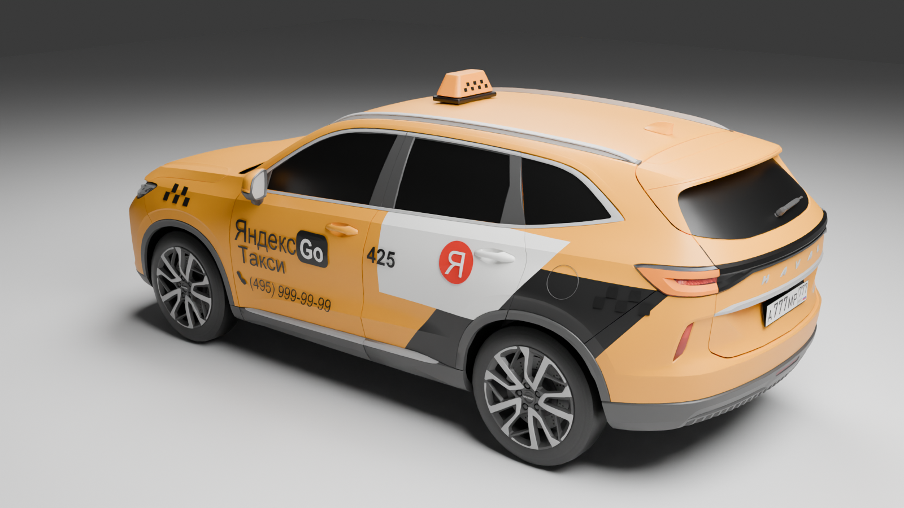
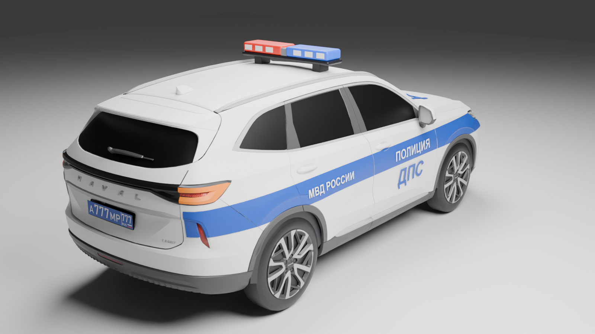
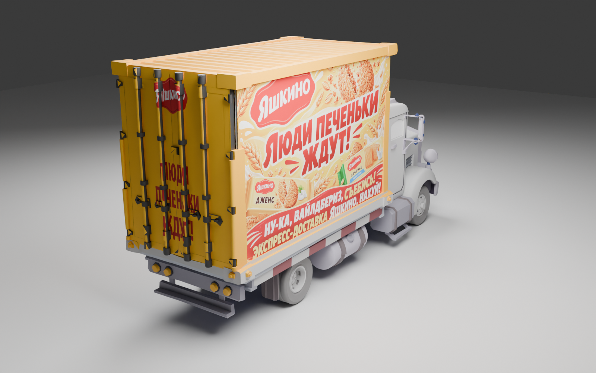

# Deadlock Local Flavor

**Знакомые вывески, еда и машины на улицах Deadlock.**

[Скачать](https://github.com/MeowKusTrue/deadlock-local-flavor/releases/latest) · [Установка](docs/INSTALL_RU.md) · [Совместимость](docs/COMPATIBILITY.md) · [English](README.en.md)

Лавка «Вкусно — и точка», меню предметов, банкомат ZБЕР, указатели, такси «Яндекс Go», ДПС и экспресс-доставка «Яшкино». Выбирайте отдельные моды или собирайте своё сочетание. Ставить всю коллекцию не обязательно.

## Быстро поставить всё или выбрать отдельно

**Один готовый набор:** [всё с белыми Haval](https://github.com/MeowKusTrue/deadlock-local-flavor/releases/download/v1.2.0/Deadlock_Local_Flavor_Complete_White_v1.2.0.zip) или [всё с жёлтыми Haval](https://github.com/MeowKusTrue/deadlock-local-flavor/releases/download/v1.2.0/Deadlock_Local_Flavor_Complete_Yellow_v1.2.0.zip). Внутри уже лавка, HUD, 16 табличек, ATM, музыка/покупка/способность, такси, ДПС и Яшкино. Включите один такой ZIP, отключив все отдельные модули коллекции.

**Свой набор:** используйте таблицы ниже. Лавка, HUD, таблички и ATM независимы; транспорт — один готовый вариант; аудио — отдельные звуки или их объединение. Не смешивайте полный набор с отдельными модулями.

## Что выбрать

**Сначала выберите машины, затем добавьте любые независимые модули и звуки.** Ни один мод не требует ставить всю коллекцию.

1. **Машины нужны?** Возьмите ровно один ZIP из автомобильной таблицы ниже. Если машины менять не хотите, пропустите этот шаг.
2. **Оформление нужно?** Лавку, HUD, таблички и банкомат можно ставить по одному или вместе. HUD — экран покупки предметов; таблички — физические панели у входов, это разные моды.
3. **Звуки нужны?** Покупка, способность и музыка выбираются независимо от оформления. Выберите All_Sounds; либо Music + Purchase_Ability; либо нужные одиночные Music/Purchase/Ability. Не дублируйте объединённые архивы их составляющими.

Для всех звуков одним файлом есть [Local_Flavor_Audio_v1.4_All_Sounds.zip](https://github.com/MeowKusTrue/deadlock-local-flavor/releases/download/v1.2.0/Local_Flavor_Audio_v1.4_All_Sounds.zip). Он заменяет отдельные Music, Purchase, Ability и Purchase_Ability.

### Оформление и звук: независимые модули

| Что хотите изменить | Что входит | Скачать ZIP |
| --- | --- | --- |
| Вкусно — и точка / Original sounds | Только модель лавки | [Vkusno_Shop_v1.2_01_Original_Sounds.zip](https://github.com/MeowKusTrue/deadlock-local-flavor/releases/download/v1.2.0/Vkusno_Shop_v1.2_01_Original_Sounds.zip) |
| Вкусно — меню / Shop menu | Только экран покупки предметов; модель лавки не меняется | [Vkusno_Menu_Mod_v1.0.zip](https://github.com/MeowKusTrue/deadlock-local-flavor/releases/download/v1.2.0/Vkusno_Menu_Mod_v1.0.zip) |
| Вкусно — указатели и меню / Entrance signs | Меню и указатели у спусков; без замены HUD | [Vkusno_Signs_v1.2.zip](https://github.com/MeowKusTrue/deadlock-local-flavor/releases/download/v1.2.0/Vkusno_Signs_v1.2.zip) |
| ZБЕР — банкомат душ | Модель, экран и звуки банкомата душ | [Zber_ATM_Mod_v1.3.zip](https://github.com/MeowKusTrue/deadlock-local-flavor/releases/download/v1.2.0/Zber_ATM_Mod_v1.3.zip) |
| Shop ambience | Только фоновая петля лавки, 9 секунд | [Local_Flavor_Audio_v1.4_Music.zip](https://github.com/MeowKusTrue/deadlock-local-flavor/releases/download/v1.2.0/Local_Flavor_Audio_v1.4_Music.zip) |
| Покупка | Только звук покупки | [Local_Flavor_Audio_v1.4_Purchase.zip](https://github.com/MeowKusTrue/deadlock-local-flavor/releases/download/v1.2.0/Local_Flavor_Audio_v1.4_Purchase.zip) |
| Повышение способности | Только джингл повышения способности | [Local_Flavor_Audio_v1.4_Ability.zip](https://github.com/MeowKusTrue/deadlock-local-flavor/releases/download/v1.2.0/Local_Flavor_Audio_v1.4_Ability.zip) |
| Покупка + повышение способности | Покупка и способность одним архивом | [Local_Flavor_Audio_v1.4_Purchase_Ability.zip](https://github.com/MeowKusTrue/deadlock-local-flavor/releases/download/v1.2.0/Local_Flavor_Audio_v1.4_Purchase_Ability.zip) |

Для новых звуков используйте лавку **Original Sounds**: у неё нет встроенных звуковых замен. Аудио 1.4 можно ставить и без неё. Purchase_Ability не содержит музыку: добавьте Music либо выберите All_Sounds вместо обоих архивов.

### Машины: одиночные, пары и всё вместе

| Сочетание | Такси | Яшкино | ДПС | Скачать один ZIP |
| --- | --- | --- | --- | --- |
| Яшкино — только грузовики | — | Да | — | [Yashkino_Trucks_v0.4.zip](https://github.com/MeowKusTrue/deadlock-local-flavor/releases/download/v1.2.0/Yashkino_Trucks_v0.4.zip) |
| Белый Haval — такси | Белый | — | — | [Yandex_Go_Haval_White_v1.0.zip](https://github.com/MeowKusTrue/deadlock-local-flavor/releases/download/v1.2.0/Yandex_Go_Haval_White_v1.0.zip) |
| Жёлтый Haval — такси | Жёлтый | — | — | [Yandex_Go_Haval_Yellow_v1.0.zip](https://github.com/MeowKusTrue/deadlock-local-flavor/releases/download/v1.2.0/Yandex_Go_Haval_Yellow_v1.0.zip) |
| Только ДПС | — | — | Да | [Haval_DPS_Only_v0.2.zip](https://github.com/MeowKusTrue/deadlock-local-flavor/releases/download/v1.2.0/Haval_DPS_Only_v0.2.zip) |
| Яшкино + белые Haval | Белый | Да | — | [Yashkino_Haval_White_v0.4.zip](https://github.com/MeowKusTrue/deadlock-local-flavor/releases/download/v1.2.0/Yashkino_Haval_White_v0.4.zip) |
| Яшкино + жёлтые Haval | Жёлтый | Да | — | [Yashkino_Haval_Yellow_v0.4.zip](https://github.com/MeowKusTrue/deadlock-local-flavor/releases/download/v1.2.0/Yashkino_Haval_Yellow_v0.4.zip) |
| ДПС + белые Haval | Белый | — | Да | [Haval_DPS_Taxi_White_v0.2.zip](https://github.com/MeowKusTrue/deadlock-local-flavor/releases/download/v1.2.0/Haval_DPS_Taxi_White_v0.2.zip) |
| ДПС + жёлтые Haval | Жёлтый | — | Да | [Haval_DPS_Taxi_Yellow_v0.2.zip](https://github.com/MeowKusTrue/deadlock-local-flavor/releases/download/v1.2.0/Haval_DPS_Taxi_Yellow_v0.2.zip) |
| ДПС + Яшкино | — | Да | Да | [Haval_DPS_Yashkino_v0.2.zip](https://github.com/MeowKusTrue/deadlock-local-flavor/releases/download/v1.2.0/Haval_DPS_Yashkino_v0.2.zip) |
| ДПС + Яшкино + белые Haval | Белый | Да | Да | [Haval_DPS_Yashkino_Taxi_White_v0.2.zip](https://github.com/MeowKusTrue/deadlock-local-flavor/releases/download/v1.2.0/Haval_DPS_Yashkino_Taxi_White_v0.2.zip) |
| ДПС + Яшкино + жёлтые Haval | Жёлтый | Да | Да | [Haval_DPS_Yashkino_Taxi_Yellow_v0.2.zip](https://github.com/MeowKusTrue/deadlock-local-flavor/releases/download/v1.2.0/Haval_DPS_Yashkino_Taxi_Yellow_v0.2.zip) |
| Яндекс Go — классическое такси / Classic taxi | Классическое | — | — | [Yandex_Go_Classic_Taxi_v1.0.zip](https://github.com/MeowKusTrue/deadlock-local-flavor/releases/download/v1.2.0/Yandex_Go_Classic_Taxi_v1.0.zip) |

«—» означает, что этот объект остаётся исходным. Только Яшкино не добавляет такси или ДПС. Только ДПС не перекрашивает грузовики. Варианты с белым/жёлтым Haval заменяют пять такси. Яшкино оформляет девять контейнерных грузовиков, включая двенадцать створок задних дверей; открытые кузова остаются открытыми.

**Классическое такси нельзя совмещать с Haval, ДПС или Яшкино отдельными архивами.** Все 12 автомобильных ZIP используют общий носитель. Белый и жёлтый Haval также взаимоисключающие. Для пары или полного набора выбирайте соответствующую строку таблицы, а отдельные автомобильные ZIP отключайте. Комбинаций классического такси с ДПС/Яшкино в этом релизе нет.

### Готовые примеры

- **Только печеньки, остальные машины обычные:** [Yashkino_Trucks_v0.4.zip](https://github.com/MeowKusTrue/deadlock-local-flavor/releases/download/v1.2.0/Yashkino_Trucks_v0.4.zip).
- **Только белые Haval:** [Yandex_Go_Haval_White_v1.0.zip](https://github.com/MeowKusTrue/deadlock-local-flavor/releases/download/v1.2.0/Yandex_Go_Haval_White_v1.0.zip).
- **Только жёлтые Haval:** [Yandex_Go_Haval_Yellow_v1.0.zip](https://github.com/MeowKusTrue/deadlock-local-flavor/releases/download/v1.2.0/Yandex_Go_Haval_Yellow_v1.0.zip).
- **Только полицейский Haval:** [Haval_DPS_Only_v0.2.zip](https://github.com/MeowKusTrue/deadlock-local-flavor/releases/download/v1.2.0/Haval_DPS_Only_v0.2.zip).
- **Белые Haval и полиция без Яшкино:** [Haval_DPS_Taxi_White_v0.2.zip](https://github.com/MeowKusTrue/deadlock-local-flavor/releases/download/v1.2.0/Haval_DPS_Taxi_White_v0.2.zip).
- **Яшкино и полиция без новых такси:** [Haval_DPS_Yashkino_v0.2.zip](https://github.com/MeowKusTrue/deadlock-local-flavor/releases/download/v1.2.0/Haval_DPS_Yashkino_v0.2.zip).
- **Все машины с жёлтыми такси:** [Haval_DPS_Yashkino_Taxi_Yellow_v0.2.zip](https://github.com/MeowKusTrue/deadlock-local-flavor/releases/download/v1.2.0/Haval_DPS_Yashkino_Taxi_Yellow_v0.2.zip).
- **Только внешний вид лавки:** Original Sounds, без других архивов.
- **Только новые звуки:** Purchase_Ability и, если хочется, Music. Модель лавки не нужна.
- **Полное оформление:** Original Sounds + HUD-меню + указатели + ATM 1.3 + один автомобильный ZIP + Purchase_Ability + музыка по желанию.

### Что отключить перед обновлением

- Для ATM 1.3 выключите старые ATM и другие замены банкомата.
- Для аудио 1.4 выключите старые Extra_Purchase_Only, Extra_Ability_Only и основные варианты лавки 02_Shop_Sounds, 03_Ability_Sound, 04_All_Sounds. Визуальную лавку замените вариантом Original Sounds. Музыку при желании верните отдельным Music.
- Для любого автомобильного ZIP выключите все остальные автомобильные архивы, прежние тесты Haval/Яшкино/ДПС, Hyundai и скрытия такси.
- В каждой другой группе оставьте одну актуальную версию. Лавку, HUD, таблички и ATM между собой отключать не нужно.

Номер Haval — **А777МР 777**. У ДПС — синий фон, белые символы и отдельное поле региона. [Подробная совместимость](docs/COMPATIBILITY.md).

## Все превью

### Лавка и банкомат

| Лавка — скриншот игры | ATM 1.3 — CPU-проекция геометрии |
| --- | --- |
|  |  |

### HUD и таблички — это разные моды

| Меню предметов — реальная текстура из проекта | Указатели и меню у входов — рендер Blender |
| --- | --- |
|  |  |

Слева показан фон категории из проекта HUD: это **не скриншот готового интерфейса**, поверх него игра размещает предметы и цены. Свежего игрового скриншота HUD пока нет. Справа — верхние таблички. Нижние входы показаны отдельно ниже; теперь в сборке 16 поверхностей.

### Нижние входы

Это CPU-проекции настоящей геометрии для проверки размещения, не игровые скриншоты.

### Рамка банкомата 1.3

CPU-проекция настоящей геометрии, не игровой скриншот. Новая рамка исправляет смещение из 1.2; отдельно в игре она ещё не подтверждена.

### Такси

| Белый Haval — спереди / сзади | Жёлтый Haval — спереди / сзади |
| --- | --- |
|   |   |

Классическое такси — исходная машина Deadlock с окраской Яндекс Go. Haval — другая внешняя модель. Все изображения машин здесь — рендеры Blender.

### ДПС и Яшкино

| ДПС — спереди / сзади | Яшкино — боковина / задние двери |
| --- | --- |
|   |   |

Это рендеры составляющих. Комбинированные ZIP содержат те же машины вместе; отдельного игрового снимка каждой комбинации пока нет. Изображения рекламы Яшкино и иллюстрации меню созданы с помощью ИИ; показанные рендеры отображают реальные материалы и геометрию мода. Рекламные обложки `shop.jpg`, `menu.jpg`, `atm.jpg` не являются игровыми снимками.

### Послушать звуки

[Покупка 1.3 — WAV](assets/purchase_v14.wav) · [Повышение способности 1.3 — WAV](assets/ability_v14.wav) · [Музыка лавки — WAV](assets/music_v14.wav)

Это сами подготовленные фрагменты. Громкость и акустика в игре могут отличаться. Покупка в 1.4 громче ещё на 1,5 дБ относительно 1.3; музыка тише на 2 дБ. Способность обрезана до 0,62 с и звучит с исходной скоростью.

## Установка

1. Скачайте нужные ZIP из [Releases](https://github.com/MeowKusTrue/deadlock-local-flavor/releases/latest). Code → Download ZIP скачивает документацию.
2. Закройте Deadlock. В мод-менеджере выберите Add Local Mod и импортируйте каждый нужный ZIP.
3. Отключите старые версии тех же модов и лишние автомобильные варианты. Включите выбранное.

В каждом обычном ZIP только один VPK в корне. Превью и исходники туда не добавлены.

Для готовых названий и обложек скачайте `Deadlock_Local_Flavor_DMM_Import_v1.2.0.zip`, распакуйте и откройте `mod-interchange.json` через Add mods → Open export file…. Карточки добавятся выключенными. Это пакет библиотеки, а не единый мод. [Подробнее](docs/MOD_MANAGER.md).

## Что обновилось в 1.2.0

- Таблички 1.2:16 поверхностей; добавлены меню на нижних SALE/TO SHOP и последнем TO SHOP у противоположной лавки.
- ATM 1.3: исправлена рамка экрана, убраны белая вставка и правый сканер, экран светлее.
- Аудио 1.4: фоновая музыка тише на 2 дБ, покупка громче ещё на 1,5 дБ. Темп и обрезка способности сохранены.
- Два полных ZIP и все отдельные модули; названия установочных файлов без test.

## Ограничения

Пользователь подтвердил в игре машины, звуки и предыдущие исправления табличек. Новая рамка ATM 1.3 исправляет регрессию 1.2 и проверена экспортом/геометрией; именно эта рамка ещё не подтверждена в игре. Последняя табличка у противоположной лавки проверена по геометрии. CRC, упаковка, зависимости и пересечения ресурсов проверены для всех архивов.

Полной подмены карты и изменений игровой коллизии нет. Под внешними моделями машин остаётся исходная геометрия. После патчей размещение или звуковые события могут потребовать обновления. Ability заменяет общий soundevents/ui.vsndevts_c и конфликтует с чужими заменами этого файла. У ATM пока нет экрана «115-ФЗ» после разрушения. Нижние таблички обоих показанных входов включены. Последний противоположный TO SHOP добавлен по геометрии без отдельного игрового теста.

## Авторство

Сборки и адаптация — MeowKusTrue. Модели лавки и ATM сделаны вручную. Для части изображений меню и Яшкино использован ИИ. Игровые ресурсы принадлежат Valve, сторонние модели, бренды и звуки — своим владельцам. Коллекция официально с ними не связана. [Авторы исходного Haval и источники](docs/CREDITS.md).

Бинарные моды находятся в Releases. Здесь — описания, превью, каталог и инструменты проверки. [Сообщить об ошибке](https://github.com/MeowKusTrue/deadlock-local-flavor/issues).
