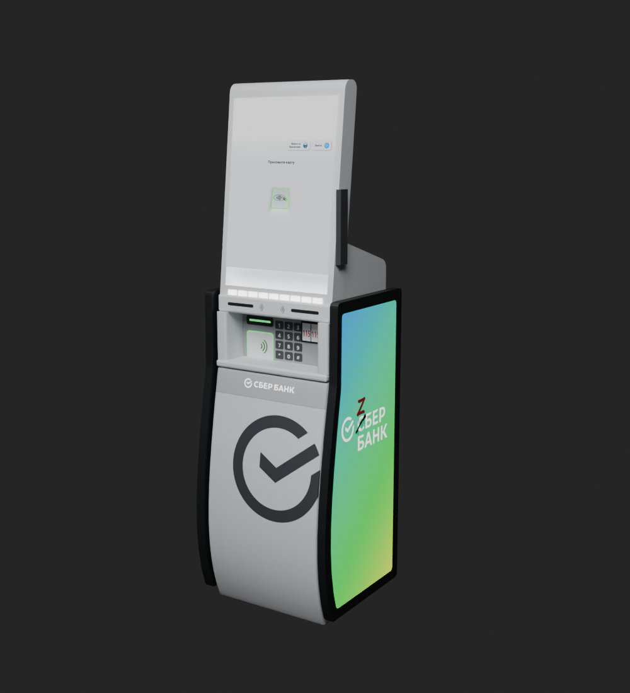

# Deadlock Local Flavor

**Знакомые вывески, еда и машины на улицах Deadlock.**

[Скачать](https://github.com/MeowKusTrue/deadlock-local-flavor/releases/latest) · [Установка](docs/INSTALL_RU.md) · [Совместимость](docs/COMPATIBILITY.md) · [English](README.en.md)

Лавка «Вкусно — и точка», меню предметов, банкомат ZБЕР, указатели, такси «Яндекс Go», ДПС и экспресс-доставка «Яшкино». Выбирайте отдельные моды или собирайте своё сочетание. Ставить всю коллекцию не обязательно.

## Что выбрать

**Сначала выберите машины, затем добавьте любые независимые модули и звуки.** Ни один мод не требует ставить всю коллекцию.

1. **Машины нужны?** Возьмите ровно один ZIP из автомобильной таблицы ниже. Если машины менять не хотите, пропустите этот шаг.
2. **Оформление нужно?** Лавку, HUD, таблички и банкомат можно ставить по одному или вместе. HUD — экран покупки предметов; таблички — физические панели у входов, это разные моды.
3. **Звуки нужны?** Покупка, способность и музыка выбираются независимо от оформления. Для покупки со способностью возьмите либо один Purchase_Ability, либо два отдельных Purchase и Ability. Не включайте все три.

### Оформление и звук: независимые модули

| Что хотите изменить | Что входит | Скачать ZIP |
| --- | --- | --- |
| Вкусно — и точка / Original sounds | Только модель лавки | [Vkusno_Shop_v1.2_01_Original_Sounds.zip](https://github.com/MeowKusTrue/deadlock-local-flavor/releases/download/v1.1.0/Vkusno_Shop_v1.2_01_Original_Sounds.zip) |
| Вкусно — меню / Shop menu | Только экран покупки предметов; модель лавки не меняется | [Vkusno_Menu_Mod_v1.0.zip](https://github.com/MeowKusTrue/deadlock-local-flavor/releases/download/v1.1.0/Vkusno_Menu_Mod_v1.0.zip) |
| Вкусно — указатели и меню / Entrance signs | Меню и указатели у спусков; без замены HUD | [Vkusno_Signs_v1.0.zip](https://github.com/MeowKusTrue/deadlock-local-flavor/releases/download/v1.1.0/Vkusno_Signs_v1.0.zip) |
| ZБЕР — банкомат душ | Модель, экран и звуки банкомата душ | [Zber_ATM_Mod_v1.1.zip](https://github.com/MeowKusTrue/deadlock-local-flavor/releases/download/v1.1.0/Zber_ATM_Mod_v1.1.zip) |
| Shop ambience | Только фоновая петля лавки, 9 секунд | [Vkusno_Shop_v1.2_Extra_Music_Only.zip](https://github.com/MeowKusTrue/deadlock-local-flavor/releases/download/v1.1.0/Vkusno_Shop_v1.2_Extra_Music_Only.zip) |
| Покупка | Только звук покупки | [Local_Flavor_Audio_v1.3_Purchase.zip](https://github.com/MeowKusTrue/deadlock-local-flavor/releases/download/v1.1.0/Local_Flavor_Audio_v1.3_Purchase.zip) |
| Повышение способности | Только джингл повышения способности | [Local_Flavor_Audio_v1.3_Ability.zip](https://github.com/MeowKusTrue/deadlock-local-flavor/releases/download/v1.1.0/Local_Flavor_Audio_v1.3_Ability.zip) |
| Покупка + повышение способности | Покупка и способность одним архивом | [Local_Flavor_Audio_v1.3_Purchase_Ability.zip](https://github.com/MeowKusTrue/deadlock-local-flavor/releases/download/v1.1.0/Local_Flavor_Audio_v1.3_Purchase_Ability.zip) |

Для новых звуков используйте лавку **Original Sounds**: у неё нет встроенных звуковых замен. Аудио 1.3 можно ставить и без неё. Музыка не входит в Purchase_Ability — она всегда отдельным ZIP.

### Машины: одиночные, пары и всё вместе

| Сочетание | Такси | Яшкино | ДПС | Скачать один ZIP |
| --- | --- | --- | --- | --- |
| Яшкино — только грузовики | — | Да | — | [yashkino_only_all_test_v0.4.zip](https://github.com/MeowKusTrue/deadlock-local-flavor/releases/download/v1.1.0/yashkino_only_all_test_v0.4.zip) |
| Белый Haval — такси | Белый | — | — | [Yandex_Go_Haval_White_v1.0.zip](https://github.com/MeowKusTrue/deadlock-local-flavor/releases/download/v1.1.0/Yandex_Go_Haval_White_v1.0.zip) |
| Жёлтый Haval — такси | Жёлтый | — | — | [Yandex_Go_Haval_Yellow_v1.0.zip](https://github.com/MeowKusTrue/deadlock-local-flavor/releases/download/v1.1.0/Yandex_Go_Haval_Yellow_v1.0.zip) |
| Только ДПС | — | — | Да | [haval_dps_only_test_v0.2.zip](https://github.com/MeowKusTrue/deadlock-local-flavor/releases/download/v1.1.0/haval_dps_only_test_v0.2.zip) |
| Яшкино + белые Haval | Белый | Да | — | [yashkino_white_all_test_v0.4.zip](https://github.com/MeowKusTrue/deadlock-local-flavor/releases/download/v1.1.0/yashkino_white_all_test_v0.4.zip) |
| Яшкино + жёлтые Haval | Жёлтый | Да | — | [yashkino_yellow_all_test_v0.4.zip](https://github.com/MeowKusTrue/deadlock-local-flavor/releases/download/v1.1.0/yashkino_yellow_all_test_v0.4.zip) |
| ДПС + белые Haval | Белый | — | Да | [haval_dps_white_test_v0.2.zip](https://github.com/MeowKusTrue/deadlock-local-flavor/releases/download/v1.1.0/haval_dps_white_test_v0.2.zip) |
| ДПС + жёлтые Haval | Жёлтый | — | Да | [haval_dps_yellow_test_v0.2.zip](https://github.com/MeowKusTrue/deadlock-local-flavor/releases/download/v1.1.0/haval_dps_yellow_test_v0.2.zip) |
| ДПС + Яшкино | — | Да | Да | [haval_dps_trucks_test_v0.2.zip](https://github.com/MeowKusTrue/deadlock-local-flavor/releases/download/v1.1.0/haval_dps_trucks_test_v0.2.zip) |
| ДПС + Яшкино + белые Haval | Белый | Да | Да | [haval_dps_trucks_white_test_v0.2.zip](https://github.com/MeowKusTrue/deadlock-local-flavor/releases/download/v1.1.0/haval_dps_trucks_white_test_v0.2.zip) |
| ДПС + Яшкино + жёлтые Haval | Жёлтый | Да | Да | [haval_dps_trucks_yellow_test_v0.2.zip](https://github.com/MeowKusTrue/deadlock-local-flavor/releases/download/v1.1.0/haval_dps_trucks_yellow_test_v0.2.zip) |
| Яндекс Go — классическое такси / Classic taxi | Классическое | — | — | [Yandex_Go_Classic_Taxi_v1.0.zip](https://github.com/MeowKusTrue/deadlock-local-flavor/releases/download/v1.1.0/Yandex_Go_Classic_Taxi_v1.0.zip) |

«—» означает, что этот объект остаётся исходным. Только Яшкино не добавляет такси или ДПС. Только ДПС не перекрашивает грузовики. Варианты с белым/жёлтым Haval заменяют пять такси. Яшкино оформляет девять контейнерных грузовиков, включая двенадцать створок задних дверей; открытые кузова остаются открытыми.

**Классическое такси нельзя совмещать с Haval, ДПС или Яшкино отдельными архивами.** Все 12 автомобильных ZIP используют общий носитель. Белый и жёлтый Haval также взаимоисключающие. Для пары или полного набора выбирайте соответствующую строку таблицы, а отдельные автомобильные ZIP отключайте. Комбинаций классического такси с ДПС/Яшкино в этом релизе нет.

### Готовые примеры

- **Только печеньки, остальные машины обычные:** [yashkino_only_all_test_v0.4.zip](https://github.com/MeowKusTrue/deadlock-local-flavor/releases/download/v1.1.0/yashkino_only_all_test_v0.4.zip).
- **Только белые Haval:** [Yandex_Go_Haval_White_v1.0.zip](https://github.com/MeowKusTrue/deadlock-local-flavor/releases/download/v1.1.0/Yandex_Go_Haval_White_v1.0.zip).
- **Только жёлтые Haval:** [Yandex_Go_Haval_Yellow_v1.0.zip](https://github.com/MeowKusTrue/deadlock-local-flavor/releases/download/v1.1.0/Yandex_Go_Haval_Yellow_v1.0.zip).
- **Только полицейский Haval:** [haval_dps_only_test_v0.2.zip](https://github.com/MeowKusTrue/deadlock-local-flavor/releases/download/v1.1.0/haval_dps_only_test_v0.2.zip).
- **Белые Haval и полиция без Яшкино:** [haval_dps_white_test_v0.2.zip](https://github.com/MeowKusTrue/deadlock-local-flavor/releases/download/v1.1.0/haval_dps_white_test_v0.2.zip).
- **Яшкино и полиция без новых такси:** [haval_dps_trucks_test_v0.2.zip](https://github.com/MeowKusTrue/deadlock-local-flavor/releases/download/v1.1.0/haval_dps_trucks_test_v0.2.zip).
- **Все машины с жёлтыми такси:** [haval_dps_trucks_yellow_test_v0.2.zip](https://github.com/MeowKusTrue/deadlock-local-flavor/releases/download/v1.1.0/haval_dps_trucks_yellow_test_v0.2.zip).
- **Только внешний вид лавки:** Original Sounds, без других архивов.
- **Только новые звуки:** Purchase_Ability и, если хочется, Music. Модель лавки не нужна.
- **Полное оформление:** Original Sounds + HUD-меню + указатели + ATM 1.1 + один автомобильный ZIP + Purchase_Ability + музыка по желанию.

### Что отключить перед обновлением

- Для ATM 1.1 выключите ATM 1.0 и другие замены банкомата.
- Для аудио 1.3 выключите старые Extra_Purchase_Only, Extra_Ability_Only и основные варианты лавки 02_Shop_Sounds, 03_Ability_Sound, 04_All_Sounds. Визуальную лавку замените вариантом Original Sounds. Музыку при желании верните отдельным Music.
- Для любого автомобильного ZIP выключите все остальные автомобильные архивы, прежние тесты Haval/Яшкино/ДПС, Hyundai и скрытия такси.
- В каждой другой группе оставьте одну актуальную версию. Лавку, HUD, таблички и ATM между собой отключать не нужно.

Номер Haval — **А777МР 777**. У ДПС — синий фон, белые символы и отдельное поле региона. [Подробная совместимость](docs/COMPATIBILITY.md).

## Все превью

### Лавка и банкомат

| Лавка — скриншот игры | ATM 1.1 — рендер Blender |
| --- | --- |
|  |  |

### HUD и таблички — это разные моды

| Меню предметов — реальная текстура из проекта | Указатели и меню у входов — рендер Blender |
| --- | --- |
|  |  |

Слева показан фон категории из проекта HUD: это **не скриншот готового интерфейса**, поверх него игра размещает предметы и цены. Свежего игрового скриншота HUD пока нет. Справа — существующие верхние таблички; новое меню дополнительных нижних табличек ещё не входит в релиз.

### Такси

| Белый Haval — спереди / сзади | Жёлтый Haval — спереди / сзади |
| --- | --- |
|   |   |

Классическое такси — исходная машина Deadlock с окраской Яндекс Go. Haval — другая внешняя модель. Все изображения машин здесь — рендеры Blender.

### ДПС и Яшкино

| ДПС — спереди / сзади | Яшкино — боковина / задние двери |
| --- | --- |
|   |   |

Это рендеры составляющих. Комбинированные ZIP содержат те же машины вместе; отдельного игрового снимка каждой комбинации пока нет. Изображения рекламы Яшкино и иллюстрации меню созданы с помощью ИИ; показанные рендеры отображают реальные материалы и геометрию мода. Рекламные обложки `shop.jpg`, `menu.jpg`, `atm.jpg` не являются игровыми снимками.

### Послушать звуки

[Покупка 1.3 — WAV](assets/purchase_v13.wav) · [Повышение способности 1.3 — WAV](assets/ability_v13.wav) · [Музыка лавки — WAV](assets/shop_music.wav)

Это сами подготовленные фрагменты. Громкость и акустика в игре могут отличаться. Покупка и способность усилены на 2,5 дБ; джингл способности обрезан до 0,62 с и звучит без ускорения.

## Установка

1. Скачайте нужные ZIP из [Releases](https://github.com/MeowKusTrue/deadlock-local-flavor/releases/latest). Code → Download ZIP скачивает документацию.
2. Закройте Deadlock. В мод-менеджере выберите Add Local Mod и импортируйте каждый нужный ZIP.
3. Отключите старые версии тех же модов и лишние автомобильные варианты. Включите выбранное.

В каждом обычном ZIP только один VPK в корне. Превью и исходники туда не добавлены.

Для готовых названий и обложек скачайте `Deadlock_Local_Flavor_DMM_Import_v1.1.0.zip`, распакуйте и откройте `mod-interchange.json` через Add mods → Open export file…. Карточки добавятся выключенными. Это пакет библиотеки, а не единый мод. [Подробнее](docs/MOD_MANAGER.md).

## Что обновилось

- ATM 1.1: экран светлее, белые полосы убраны, низ корпуса исправлен, боковые панели сглажены.
- Аудио 1.3: покупка и повышение способности громче на 2,5 дБ. Джингл обрезан до 0,62 с, исправлен ускорявший его pitch события.
- Добавлены Haval, ДПС, Яшкино и готовые сочетания. Haval увеличен ещё на 2% относительно предыдущей рабочей примерки.

Старые звуковые варианты лавки 02_Shop_Sounds, 03_Ability_Sound, 04_All_Sounds и старые Extra покупки/способности остались в [релизе 1.0.0](https://github.com/MeowKusTrue/deadlock-local-flavor/releases/tag/v1.0.0). Для новых звуков используйте лавку Original Sounds, музыку отдельно по желанию и аудио 1.3. Старые звуковые пакеты одновременно не включайте.

## Ограничения

Проверены упаковка, контрольные суммы, зависимости собранных моделей и пересечения путей. Новые ATM, аудио и автомобильные сборки проверены офлайн; финальный игровой тест каждой новой сборки ещё не выполнен. Предыдущую примерку Haval автор проверял в игре.

Полной подмены карты и изменений игровой коллизии нет. Под внешними моделями машин остаётся исходная геометрия. После патчей размещение или звуковые события могут потребовать обновления. Ability заменяет общий soundevents/ui.vsndevts_c и конфликтует с чужими заменами этого файла. У ATM пока нет экрана «115-ФЗ» после разрушения. Дополнительное меню нижних табличек подвала ещё в работе и в релиз не включено.

## Авторство

Сборки и адаптация — MeowKusTrue. Модели лавки и ATM сделаны вручную. Для части изображений меню и Яшкино использован ИИ. Игровые ресурсы принадлежат Valve, сторонние модели, бренды и звуки — своим владельцам. Коллекция официально с ними не связана. [Авторы исходного Haval и источники](docs/CREDITS.md).

Бинарные моды находятся в Releases. Здесь — описания, превью, каталог и инструменты проверки. [Сообщить об ошибке](https://github.com/MeowKusTrue/deadlock-local-flavor/issues).
